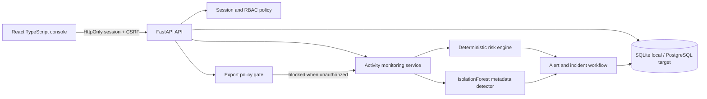

# CareShield AI architecture

## System shape

## Request and decision flow

1. The browser signs in through `/api/auth/login`. The API verifies an Argon2id hash and creates an expiring session row; the session token is stored only in an HttpOnly cookie. A separate CSRF cookie is echoed in a request header for state-changing requests.
2. Every protected endpoint resolves the user from the session and applies role checks. Patient detail and history endpoints also require a matching `patient_assignments` row. Administrator access to settings does not imply clinical record access.
3. Sensitive operations call the backend activity service. The service records metadata such as actor role, action, resource reference, authorization result, record count, destination category, risk score, signals, and response; it never copies a patient payload into the event.
4. The rules engine returns a bounded 0–100 score, severity, signals, explanation, and recommendation. The ML component produces a separate calibrated anomaly score. The UI displays those as rule/ML/combined concepts.
5. Scores at or above 50 create a persisted alert. Analysts can acknowledge and resolve alerts. Each action creates an `incident_actions` audit row.
6. The export endpoint checks both destination policy and role before returning any payload. Unauthorized export requests are recorded, scored as critical, alerted, and returned with `export_payload: null`.

## Data protection choices

- Synthetic IDs use `SYN-####`; UI uses masked display names in directory views.
- Security events contain references and metadata, not diagnoses, addresses, health identifiers, or complete records.
- The model feature list is fixed to metadata: access volume, frequency, denied attempts, department mismatch, timing, bulk operation, and unauthorized export.
- Pseudonymization reduces exposure but is not complete anonymization; access to the underlying synthetic record remains controlled by policy.
- No patient data is sent to an external AI provider.

## Roles

| Role | Example access |
| --- | --- |
| Doctor | Assigned synthetic records and their history |
| Nurse | Assigned care-team records and their history |
| Security analyst | Minimized patient directory, events, alerts, incident response |
| Administrator | Users, settings, incident response; no automatic clinical record access |

## Operations

Local SQLite is selected for zero-dependency startup. PostgreSQL is the preferred shared deployment database. Indexes cover timestamps, actor/timestamp, severity, actions, assignments, and alert status. Health endpoints report database and model state. Structured production logging, centralized rate limiting, managed secrets, backups, TLS termination, and tamper-resistant audit retention belong in the deployment layer.

