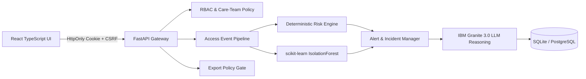

# CareShield AI Architecture

## Overview & Datathon Track Alignment
CareShield AI is built for **IBM Z Datathon 2026 — Theme 2: AI Secured: Innovation Without Exposure**. It delivers runtime patient data access governance by pairing structured predictive anomaly detection with generative LLM reasoning, deployed natively on an IBM LinuxONE (s390x) mainframe instance.

## System Topology

